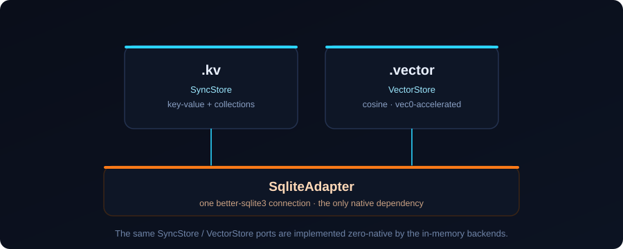

<p align="center">
  
</p>

# mirk

> **One place for everything your app remembers.** Settings, records, search, embeddings, the
> links between things, authored content, and generated files. Start with a single file on disk,
> and move to a bigger database later without rewriting your app.

    

## Why

Say you are building a notes app, a game, or an AI assistant. Sooner or later it has to remember
things: user settings, lists of tasks or saves, text people can search, embeddings for "find me
something like this", links between people or pages, the content you write for it, and the images
or exports it produces. Each of those usually becomes another library, another service, or another
folder of files with its own rules.

**mirk** puts all of it behind one small API. On day one it is a single SQLite file on disk, or
plain memory in tests. When you outgrow that, you switch to Postgres, the browser, or a hosted
database behind the same interfaces.

A few ways it gets used:

- **An AI assistant's memory.** Facts as records, embeddings for recall, and full-text search over
  past conversations, saved together in one file and updated together in one transaction.
- **A game.** Items, quests, and characters written as checked data packs, with player saves stored
  beside them and the links between characters walked like a graph.
- **A writing tool.** Drafts kept as Markdown files that people edit by hand, and still listed,
  filtered, and sorted like database records.
- **An image or export pipeline.** Every generated file stored with a checksum and a record of what
  it was made from, so a half-written file never shows up and nothing loses its history.

### Why not a simple key-value store?

A key-value library answers _where do I put this value?_ That is enough until the app needs the
open tasks sorted by due date, the notes that mention "invoice", or the documents closest to an
embedding. mirk answers a bigger question: _where does my app's data live, and will it behave the
same when I move it?_

"Behaves the same" is tested, not assumed. About 200 shared scenarios fix the details that usually
drift between backends. A task with no due date sorts last in both directions. Equal values keep
the order they were written in. Paging happens after sorting. The in-memory store and both SQLite
adapters must pass every scenario. The Python port runs them too, against the same SQLite files
TypeScript writes.

## A first look

```ts
import { NodeSqliteAdapter } from "@mirk/store/node-sqlite"; // Node 24+, nothing to install

const db = new NodeSqliteAdapter({ path: "app.db" });

// Key-values and queryable collections
db.kv.set("settings", { theme: "dark" });
db.kv.put("tasks", { id: "t1", title: "Send invoice", status: "open", due: "2026-11-01" });
db.kv.list("tasks", { where: { status: "open" }, sortBy: "due" });

// Full-text search
db.search.index("notes", { id: "n1", fields: { title: "Invoice", body: "Send the October invoice" } });
db.search.search("notes", "invoice");

// Vector search, ranked by exact cosine
const embedding = new Float32Array(768); // your model's output
db.vector.upsert("docs", { id: "a", vector: embedding });
db.vector.search("docs", embedding, { topK: 10 });

// One transaction across all of it
db.transaction(() => {
  db.kv.put("tasks", { id: "t2", title: "Pay deposit", status: "open", due: "2026-10-30" });
  db.search.index("notes", { id: "n2", fields: { title: "Deposit", body: "Pay the venue deposit" } });
});

db.close();
```

Code that takes the interface instead of the adapter runs on any store that provides it:

```ts
import { InMemoryKv, toAsync, type SyncStore } from "@mirk/store/kv";

function openTasks(store: SyncStore) {
  return store.list("tasks", { where: { status: "open" }, sortBy: "due" });
}

openTasks(new InMemoryKv()); // in tests
openTasks(db.kv);            // in the app
toAsync(db.kv);              // the same store, with the async interface remote backends use
```

## One file, many capabilities

A **source adapter** opens one connection and hangs each capability off it: `.kv`, `.vector`,
`.search`. You do not run three libraries with three connections and three transaction scopes.

<p align="center">
  
</p>

Each capability is its own import, so you load only what you use. Importing `@mirk/store/kv` loads
no database at all.

Local stores are **synchronous**, because a local SQLite call finishes in microseconds and a
Promise around it only adds cost. Remote backends are async, and `toAsync` gives any local store
the same async shape.

## Choosing a store

| You want                                   | Use                                        | Covers                                  |
| ------------------------------------------ | ------------------------------------------ | --------------------------------------- |
| To build and test with nothing installed   | the in-memory stores in `@mirk/store`      | everything                              |
| A local database file on Node 24+          | `@mirk/store/node-sqlite`                  | everything                              |
| A local database file on Node 22           | `@mirk/store/sqlite` with `better-sqlite3` | everything                              |
| Records that people edit as Markdown files | `@mirk/store-markdown`                     | key-values and collections              |
| Storage in the browser                     | `@mirk/store-indexeddb`                    | key-values and collections              |
| A hosted SQLite database (Turso, `sqld`)   | `@mirk/store-libsql`                       | key-values, collections, vectors, transactions |
| Many processes writing at once             | `@mirk/store-postgres`                     | key-values, collections, transactions   |
| SurrealDB, embedded or remote              | `@mirk/surreal`                            | key-values, collections, vectors, links |
| A dedicated vector database                | `@mirk/vector-qdrant`                      | vectors                                 |

The in-memory and SQLite stores are the reference. The IndexedDB and Qdrant adapters also run the
shared scenarios for what they cover. Each package README lists any place where it differs from the
reference.

## Authored data: fixtures

Most apps ship data that people write rather than code: default settings, themes, templates,
prompts, game items, content packs, test fixtures. Reading that data is easy. Trusting it is the
hard part. [`@mirk/fixtures`](packages/fixtures) turns those files into checked records:

- Each record is validated against a schema when it loads.
- Layers stack in a fixed order, for example built-in defaults, then app overrides, then user
  overrides. An override can change one field without copying the whole record.
- References between records, such as a quest that names an item, are checked to exist.
- Every value records which layer it came from, so a tool or a person can see why it has the value
  it has.

The same pack loads from a folder during development, from files bundled inside a package, or from
a mirk store in production. A `mirk-fixtures` command-line tool validates and explains packs.

## Generated files: artifacts

Apps that generate files, such as images, audio, exports, or model outputs, need to know that a
file is intact, where it came from, and that a half-written file never becomes visible.
[`@mirk/artifact`](packages/artifact) gives each file:

- a SHA-256 checksum, checked when it is stored and again whenever you ask
- metadata and lineage: the inputs or parent files it was made from
- an all-or-nothing finish, so readers only ever see complete files
- cleanup that never deletes a file a writer is still finishing, and that shows its plan before it
  deletes anything

Metadata lives in a mirk store. The bytes live on disk, on S3 and other object stores through
[`@mirk/artifact-opendal`](packages/artifact-opendal), or in private Vercel Blob storage through
[`@mirk/artifact-vercel-blob`](packages/artifact-vercel-blob).

## Also in the box

- **Moving between backends** — [`@mirk/migrate`](packages/migrate) copies data from one store to
  another and resumes where it stopped.
- **Revision history** — [`@mirk/statements`](packages/statements) is specialized storage for hosts
  that track what was true and when it was recorded.

## Python

The Python packages implement the same interfaces and run the same scenarios. They open SQLite files
written by TypeScript, and TypeScript opens theirs.

| Package                 | What it does                                                         |
| ----------------------- | -------------------------------------------------------------------- |
| `mirk-store`            | key-values, collections, vectors, search, and links on stdlib SQLite |
| `mirk-fixtures`         | authored data packs                                                  |
| `mirk-artifact`         | files and blobs, readable from TypeScript                            |
| `mirk-store-markdown`   | Markdown file storage                                                |
| `mirk-artifact-opendal` | file bytes on S3-compatible storage                                  |
| `mirk-vector-qdrant`    | vectors on Qdrant                                                    |

## Install

```bash
npm install @mirk/store
npm install better-sqlite3   # only for @mirk/store/sqlite
```

ESM only. Use a patched Node release: 22.23.4+, 24.22.1+, or 26.12.1+. The built-in
`node:sqlite` adapter needs Node 24 or later.

## Status

Pre-1.0: minor versions may change APIs. Each package README is that package's contract. Release
history is in [`CHANGELOG.md`](CHANGELOG.md), planned work is in
[`docs/roadmap.md`](docs/roadmap.md), and development and release steps are in
[`CONTRIBUTING.md`](CONTRIBUTING.md).

## License

Apache-2.0. See [LICENSE](LICENSE).
