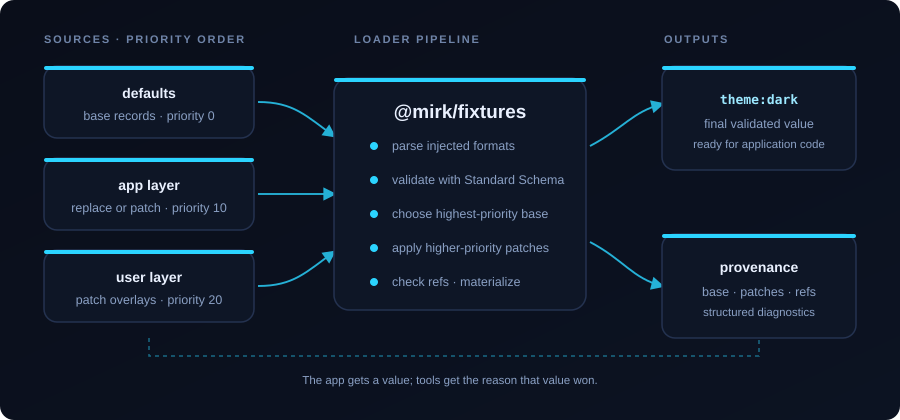
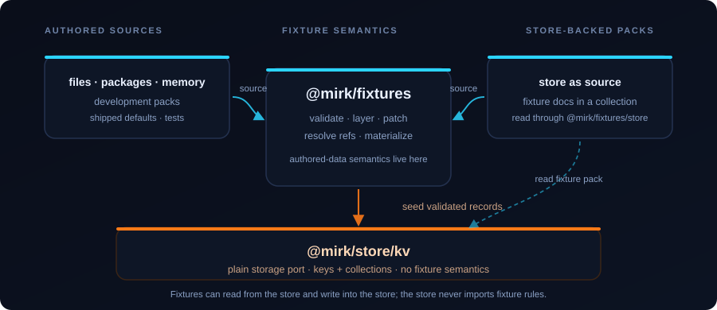

# @mirk/fixtures

> **Authored data you can trust.** Defaults, themes, templates, prompts, content packs, and test
> fixtures, loaded as validated records, layered in a fixed order, and able to say where every
> value came from.

## Why

Most apps ship data that people write rather than code: default settings, themes, templates,
prompts, game items, lookup tables, test fixtures. Reading that data is easy. Trusting it is the
hard part. Once it matters, the same questions come up every time:

- What shape is this record supposed to have, and who checks it?
- The built-in defaults, the app, and the user all define `theme:dark`. Which one wins?
- Can a user override change one field, or must it copy the whole record?
- A template names a theme. Does that theme exist?
- A value looks wrong. Which file did it come from?
- Can the same pack load from a folder during development, from files inside a package, and from a
  database in production?

`@mirk/fixtures` answers each of them. Every record is checked against a schema when it loads.
Sources stack in a priority order you set, and a higher priority wins. An override is a small patch that names its target.
References between records are checked to exist. Every loaded value carries its **provenance**:
the list of files and layers that produced it.

## A first look

Two sources define the same theme. The app's defaults hold the full record, and a user's override
patches one field:

```ts
import { z } from "zod"; // any Standard Schema validator works
import { createFixtureLoader, createFixtureRegistry, defineFixtureType } from "@mirk/fixtures";
import { createMemoryFixtureSource } from "@mirk/fixtures/memory";

const registry = createFixtureRegistry();
registry.register(defineFixtureType({
  type: "theme",
  directory: "themes",
  schema: z.object({ background: z.string(), accent: z.string() }),
  mergeStrategy: "deep",
}));

// What ships with the app
const defaults = createMemoryFixtureSource({
  id: "defaults",
  files: { "themes/dark.json": '{ "background": "#050507", "accent": "#22d3ee" }' },
});

// One user's override: a patch that changes one field
const user = createMemoryFixtureSource({
  id: "user",
  files: { "themes/dark.json": '{ "$patch": "theme:dark", "accent": "#8b5cf6" }' },
});

const loader = createFixtureLoader({ registry, sources: [defaults, user] });

const { value, provenance } = await loader.loadRaw("theme:dark");
```

`value` is the merged, validated record:

```js
{ background: '#050507', accent: '#8b5cf6' }
```

and `provenance.layers` says how it was built:

```js
[
  { sourceId: 'defaults', layer: 'defaults', priority: 0, path: 'themes/dark.json', kind: 'base' },
  { sourceId: 'user',     layer: 'user',     priority: 1, path: 'themes/dark.json', kind: 'patch' }
]
```

In a real app the sources are a folder, files inside your package, or a mirk store, and
`loader.load("theme:dark")` returns just the value. The `mirk-fixtures` command-line tool runs the
same checks and explanations from a terminal.

## Install

```bash
npm install @mirk/fixtures
```

ESM only. On Node, use `^22.23.4 || ^24.22.1 || >=26.12.1`.

Each part is its own import. The root entry stays dependency-light and runtime-neutral: it never
pulls filesystem APIs, parser bundles, database bindings, or CLI code into a browser or edge
bundle. Source helpers and the CLI live behind explicit subpaths.

| Import                      | What you get                                                | Node-only |
| --------------------------- | ----------------------------------------------------------- | --------- |
| `@mirk/fixtures`            | registry, type definitions, loader, refs, errors            | no        |
| `@mirk/fixtures/memory`     | in-memory source for tests, examples, and generated packs   | no        |
| `@mirk/fixtures/store`      | store-backed source and store seeding over `@mirk/store/kv` | no        |
| `@mirk/fixtures/filesystem` | filesystem source for local directories and CLI workflows   | yes       |
| `@mirk/fixtures/package`    | file-backed defaults shipped inside a package               | yes       |
| `@mirk/fixtures/cli`        | explicit-config CLI helpers and the `mirk-fixtures` binary  | yes       |

## Refs and ids

Every fixture has a stable **ref** of the form `<type>:<id>`, such as `theme:dark`,
`template:welcome`, or `prompt:code-review`. The type must be registered before anything of that
type loads. The id comes from the source, not from your disk: it is the file's name with the
matched extension removed, so `themes/dark.json` is `theme:dark`. It is never an absolute path.

`refString`, `parseRef`, `formatRef`, `isCanonicalRef`, and `isExplicitRef` from the root handle refs
directly.

## Defining a type

A **fixture type** says where documents of one kind live and what shape they have.
`defineFixtureType` returns the definition unchanged and keeps TypeScript inference at the call
site. `registry.register(def)` returns nothing; it rejects a duplicate type name, and it rejects a
type that declares neither `jsonSchema` nor `schema`. `registry.types()` returns type names in
Unicode code point order.

| Field                | Meaning                                                                                  |
| -------------------- | ---------------------------------------------------------------------------------------- |
| `type`               | Namespace used in refs. Required.                                                        |
| `directory`          | Source-relative directory holding documents of this type. Required.                      |
| `jsonSchema`         | JSON Schema 2020-12 document for the authored shape. See below.                          |
| `schema`             | Standard Schema v1 validator. See below.                                                 |
| `extensions`         | Accepted extensions. Defaults to the extensions that have registered parsers.            |
| `document`           | `{ kind: "map", idField? }` to author several fixtures in one file.                      |
| `mergeStrategy`      | How patches merge. Defaults to `replace`.                                                |
| `referenceMode`      | `explicit-only` (default) or `explicit-and-bare`. Overrides the loader-wide setting.     |
| `extractReferences`  | `(value) => Array<{ ref, fieldPath }>`, added to the built-in extraction.                |
| `validateReferences` | `(value, ctx) => Diagnostic[]`, cross-document checks run by `validate()`.               |
| `materialize`        | `(value, ctx) => runtime value`, used by `loader.materialize()`.                         |
| `purpose`            | Tooling hint: `archetype`, `component`, `lookup`, `factory`, or `raw`.                   |

### Validation: `jsonSchema` and `schema`

A type declares its shape one of two ways, and may declare both.

**`schema`** is a Standard Schema v1 validator, as in the first look. The package does not choose
Zod, Valibot, ArkType, or any other validator for you.

**`jsonSchema`** is a JSON Schema 2020-12 document. It is data, not code, so the same declaration
validates the same authored files in TypeScript and in the Python port. You supply the engine,
because the root entry stays browser-safe and free of runtime dependencies. With Ajv:

```ts
import Ajv2020 from "ajv/dist/2020.js";

const themeType = defineFixtureType({
  type: "theme",
  directory: "themes",
  jsonSchema: {
    type: "object",
    required: ["name"],
    properties: { name: { type: "string" } },
  },
});

const loader = createFixtureLoader({
  registry,
  sources: [defaults],
  jsonSchemaValidator: (document) => {
    const validate = new Ajv2020({ allErrors: true }).compile(document);
    return (value) =>
      validate(value)
        ? []
        : (validate.errors ?? []).map((error) => ({
            message: error.message ?? "invalid",
            path: error.instancePath.slice(1).split("/").filter(Boolean),
          }));
  },
});
```

The loader compiles each type's document once. A type that declares `jsonSchema` while the loader
has no `jsonSchemaValidator` fails loudly (`no-json-schema-validator`) rather than loading
unvalidated data. `jsonSchema: true` is the explicit way to say "any document"; it still needs a
validator, which for `true` can be one that returns `[]`.

When both are present, `jsonSchema` runs first and the Standard Schema's output becomes the fixture
value. Either way a failure is one error, `FixtureValidationError`, and one diagnostic code,
`schema-invalid`.

### Several fixtures in one file

One file can author several fixtures of the same type. Opt the type into **map documents** and,
when useful, have the loader copy each key into an `id` field:

```ts
const backgroundType = defineFixtureType({
  type: "background",
  directory: "backgrounds",
  document: { kind: "map", idField: "id" },
  schema: BackgroundSchema,
  mergeStrategy: "deep",
});
```

```json
{
  "drifter": { "name": "Drifter" },
  "detective": { "name": "Detective" }
}
```

The records load separately as `background:drifter` and `background:detective`. With `idField`
set, the key fills a missing field on a base record, and an explicitly different value is
rejected. A higher layer can patch either record by putting the same key in its own map document,
with an ordinary `$patch` value. Provenance names both the file and the key, such as
`backgrounds/core.json#detective`.

## Layers and patches

A **source** is anything that can list documents and read them. The loader stacks sources into
**layers** by priority:

```ts
const loader = createFixtureLoader({
  registry,
  sources: [
    { source: defaults, layer: "base", priority: 0 },
    { source: app, layer: "app", priority: 10 },
    { source: user, layer: "user", priority: 20 },
  ],
});
```

A plain source in the array is shorthand for `{ source, layer: source.id, priority: <array index> }`,
which is what the first look used. Equal priorities are allowed; declaration order breaks the tie.
Layer names such as `base`, `app`, or `user` are conventions only; the loader treats no name
specially. Every source in one loader must have a distinct `id`.

A document is either a **base** (a full record) or a **patch**: an object with a `$patch` key naming
the ref it changes.

```json
{
  "$patch": "theme:dark",
  "colors": {
    "accent": "#8b5cf6"
  }
}
```

The highest-priority base wins. Patches above it then apply in priority order. A patch at or below
the winning base's priority is not applied, and provenance marks it `shadowed`. The `$patch` value
must exactly match the ref being loaded, including inside map documents; a mismatch is
`patch-ref-mismatch`, even for a patch that would have been shadowed.

### Merge strategies

The type's `mergeStrategy` decides how a patch combines with the value below it.

| Strategy        | Behavior                                                                                      |
| --------------- | --------------------------------------------------------------------------------------------- |
| `replace`       | The patch body replaces the value. The default.                                              |
| `deep`          | Plain objects merge recursively; arrays and scalars replace.                                  |
| `array-replace` | Plain objects merge one level deep; every incoming field, including arrays, replaces.         |

`deep` treats only plain objects as mergeable. Dates, Maps, Sets, class instances, and typed arrays
replace like scalars. There is no deletion marker: under `deep` and `array-replace` a patch can add
and overwrite keys but not remove one, and under `replace` the patch body (minus `$patch`) becomes
the whole value.

A custom strategy is a function `(existing, incoming, ctx) => merged`. `ctx.fixture` is the target
ref and `ctx.layers` lists the layers applied so far. Merge functions must not mutate their inputs;
the built-in strategies clone. The merged value is validated like any other.

### Provenance

`loadRaw(ref)` returns `{ ref, type, id, value, provenance }`. `provenance.finalRef` is the ref,
and `provenance.layers` lists every document that took part, lowest priority first. Each layer has
`sourceId`, `layer`, `priority`, `path`, and a `kind`:

- `base`: the selected base document;
- `replace`: a lower-priority base that the selected base replaced;
- `patch`: a patch that was applied;
- `shadowed`: a patch that was not applied because it sat at or below the base.

`path` is the normalized source-relative path. Provenance never contains absolute filesystem paths,
package roots, or backend connection details, so it is safe to show in a CLI or UI.

<p align="center">
  
</p>

### The loading steps

For `loadRaw("type:id")` the loader:

1. Parses the ref and finds the registered type (`invalid-ref`, `unknown-type`).
2. Lists every source and matches entries directly under the type directory with an accepted
   extension. Files in nested subdirectories are ignored.
3. Reads and parses each match. A single document is one fixture named by its filename; a map
   document is one fixture per top-level key.
4. Classifies each value as a base document or a patch document (an object with `$patch`).
5. Selects the highest-priority base. With no base at all, it raises `patch-without-base`; with no
   document at all, `not-found`.
6. Validates the base against the type's schema.
7. Applies patches with a higher priority than the base, in priority order, removing the `$patch`
   key and validating after every merge, so a schema error is attributed to the patch that caused
   it.
8. Records provenance and caches the result by ref.

## References

Fixtures refer to other fixtures with an explicit `$ref` object:

```json
{
  "title": "Welcome",
  "theme": { "$ref": "theme:dark" }
}
```

Explicit `{ $ref }` objects are always recognized. Bare `"type:id"` strings count only when you opt
in with `referenceMode: "explicit-and-bare"`, on the loader or on one type, so prose-heavy records
do not turn into reference graphs by accident. Even then, a bare string counts only when the whole
string is a canonical ref; a ref-shaped substring inside prose never does. A type's
`extractReferences` adds references the built-in walk cannot see.

`loader.resolveRef(value, expectedType?)` turns a ref-or-inline value into a fixture value:

- a ref loads the referenced fixture, and a ref of the wrong type is `type-mismatch`;
- an inline value with `expectedType` is validated against that type's schema;
- an inline value without `expectedType` is returned unchanged.

### Checking a whole pack

```ts
const report = await loader.validate();        // or loader.validate("theme:dark")
const graph = await loader.referenceGraph();
```

`validate()` loads every listed fixture, runs schema validation, checks every extracted reference,
and runs each type's `validateReferences` hook. It returns `{ ok, diagnostics }`, where `ok` means
no diagnostic has severity `error`. It keeps going after a failure: one bad file or one failing
source contributes diagnostics while the rest of the pack is still checked. Missing targets are `missing-reference`; malformed refs are `invalid-ref`. A file that fails to
read or parse yields its own diagnostic and is left out of the run; every other file, including the
rest of its source, is still checked. A reference that could point into a file left out that way is
reported as the warning `unresolved-reference` instead of `missing-reference`.

`referenceGraph()` returns `{ nodes, edges, diagnostics }`. Nodes are `{ ref, type, id, resolved }`;
edges are `{ from, to, fieldPath }`. Dangling targets stay in the graph as `resolved: false`, and
malformed refs become diagnostics rather than crashing construction.

`loader.list(type?)` returns every ref the sources define, in code point order.

## Materialization

The raw value is the validated document. A type's `materialize` hook can build a runtime value
from it, such as a compiled template:

```ts
const raw = await loader.load("prompt:review");
const compiled = await loader.materialize("prompt:review");
```

A type without `materialize` passes the raw value through. The hook receives `ctx.loadRaw(ref)` and
`ctx.materialize(ref)` so it can compose other fixtures. Re-entering a ref already being
materialized in the same call chain raises `materialization-cycle`.

Raw and materialized values are cached separately. `loader.invalidate(ref)` drops that raw value and
every materialized value; `loader.invalidate()` drops everything.

## Sources

The memory source, used in the first look, holds documents in a plain object keyed by path. It is
the source for tests, examples, and generated packs.

### Folders and package files

Node applications can load an ordinary directory:

```ts
import { createFilesystemFixtureSource } from "@mirk/fixtures/filesystem";

const local = createFilesystemFixtureSource({ id: "local", root: "./fixtures" });
```

A package can ship file-backed defaults next to its own code:

```ts
import { createPackageFixtureSource } from "@mirk/fixtures/package";

const defaults = createPackageFixtureSource({
  id: "defaults",
  rootUrl: new URL("./fixtures/", import.meta.url),
});
```

Both resolve the root's real path once, when the source is created. Every discovered file is
resolved to its real path and rejected if it lands outside the root, so a symlink pointing outward
is an error rather than a leak. Listed paths are relative to the root, use `/` separators, and come
back in deterministic order. Relative paths with `..`, empty segments, backslashes, or an absolute
prefix are rejected. The package source needs a `file:` root URL; it does not read bundled browser
manifests.

### A mirk store

Use `@mirk/fixtures/store` when authored data crosses the storage boundary: read fixture documents
from a store collection, or seed validated fixture values into ordinary store collections.
`@mirk/store` knows nothing about fixtures; the dependency runs one way.

<p align="center">
  
</p>

**Reading fixtures from a store.** Fixture documents live as items in a collection:

```ts
import { createStoreFixtureSource } from "@mirk/fixtures/store";

const source = createStoreFixtureSource({
  id: "db",
  store: adapter.kv,
  collection: "fixtures",
  pathPrefix: "themes", // optional
});
```

The store only needs `list(collection)` and `getById(collection, id)`, sync or async, so any
`@mirk/store/kv` backend works. Each item is:

```ts
interface StoredFixtureItem {
  id: string;
  content: string;       // the document text, parsed like a file
  extension: string;     // e.g. ".json"
  relativePath?: string;
  updatedAt?: string;
  meta?: Record<string, unknown>;
}
```

The item's path is its `relativePath` when present, otherwise `<pathPrefix>/<id><extension>`. Reads
go through the item id, never through the path, so ids containing dots, slashes, or extension-like
suffixes work. Pass `mapItem` to adapt a differently shaped item. The collection layout is yours to
choose.

The source caches its listing. To pick up writes in a long-running process, call
`source.invalidate()` to drop the listing and then `loader.invalidate()` to drop values built from
it.

**Seeding a store from fixtures.** Validated fixtures can fill ordinary collections:

```ts
import { seedStoreFromFixtures } from "@mirk/fixtures/store";

const { written, skipped } = await seedStoreFromFixtures({
  loader,
  store: adapter.kv,
  targets: { theme: "themes", template: "templates" },
  mode: "upsert",
});
```

- `targets` maps fixture type names to collection names explicitly.
- `mode` is `upsert` (the default) or `insert-only`, which skips ids that already exist and reports
  them in `skipped`.
- Each item is `{ id, value }` with `id` equal to the fixture id; `includeProvenance: true` adds
  `provenance`, and `mapItem(fixture)` replaces the item shape entirely.
- Every fixture is loaded and validated before the first write. A failure throws
  `seed-validation-failed` and writes nothing. `validateBeforeWrite: false` skips the full
  `validate()` pass, though schema validation still runs on load.
- A write that fails partway through is not rolled back; items already written stay written.

### Writing your own source

A source lists entries and reads them:

```ts
interface FixtureSourceEntry {
  relativePath: string; // matched against type directory and extension; shown in provenance
  locator: string;      // opaque, source-owned read token
}

interface FixtureSource {
  readonly id: string;
  list(): MaybePromise<readonly FixtureSourceEntry[]>;
  read(entry: FixtureSourceEntry): MaybePromise<string>;
}
```

A source reads by `locator`, never by re-deriving identity from `relativePath`. Sources, parsers,
validators, and hooks may be sync or async; the loader normalizes everything to promises.

## Parsers

JSON is built in. YAML, JSON5, TOML, or custom formats are your choice, supplied by extension:

```ts
import { parse as parseYaml } from "yaml";

const loader = createFixtureLoader({
  registry,
  sources,
  parsers: { ".yaml": parseYaml },
});
```

A parser is a function from text to a value, and may be async. A parser can also be a
`{ kind, parse }` entry where `kind` is `plain`, `async`, `positioned`, or `async-positioned`. A
positioned parser returns `{ value, positionFor(path) }`, which adds a line/column `range` to
diagnostics about a field of that document: schema failures, `missing-reference` and
`invalid-ref`. Positions only enrich diagnostics; a parser whose `positionFor` throws or returns
nothing leaves the `range` off and changes no result.

A matching file with no parser for its extension is a `no-parser` diagnostic. A parse failure is a
`parse-failed` diagnostic carrying the source id, relative path, and the parser's message.

## CLI

The `mirk-fixtures` command validates, lists, shows, and explains a pack from a terminal. It takes
an explicit JavaScript configuration module:

```js
// mirk.fixtures.mjs
import { z } from "zod";
import { createFixtureRegistry, defineFixtureType } from "@mirk/fixtures";
import { createFilesystemFixtureSource } from "@mirk/fixtures/filesystem";

export const registry = createFixtureRegistry();
registry.register(defineFixtureType({
  type: "theme",
  directory: "themes",
  schema: z.object({ background: z.string(), accent: z.string() }),
}));

export const sources = [createFilesystemFixtureSource({ id: "local", root: "./fixtures" })];
```

```text
$ mirk-fixtures explain mirk.fixtures.mjs theme:dark
ref: theme:dark
layers:
- base source=local layer=local priority=0 path=themes/dark.json
```

The commands:

```text
mirk-fixtures validate <config>
mirk-fixtures list <config> [--type <type>]
mirk-fixtures show <config> <type:id> [--raw|--materialized]
mirk-fixtures explain <config> <type:id>
mirk-fixtures graph <config> [--format json|dot]
```

`<config>` is the path to a `.mjs` or `.js` module. `validate`, `list`, and `graph` may leave it
out, and then use `mirk.fixtures.mjs` in the current directory. The module exports
`{ registry, sources, parsers }` (and optionally `referenceMode`), or a constructed loader as its
default export or as `loader`. A pack with `jsonSchema` types exports a constructed loader, because
that is where `jsonSchemaValidator` is passed. The CLI discovers nothing on its own: parser packages are imported by the configuration module, TypeScript
configuration is not supported, and authored content is never evaluated as code.

Every command prints deterministic human output, or with `--json` this envelope:

```ts
interface FixtureCliEnvelope<T> {
  schema: "mirk-fixtures-cli/v1";
  command: string;
  ok: boolean;
  result?: T;
  diagnostics: readonly Diagnostic[];
}
```

Exit codes: `0` no error diagnostics; `1` fixture, parse, schema, reference, or materialization
failure; `2` CLI usage or configuration failure; `3` source access or unexpected internal failure.
Absolute paths are hidden unless `--debug-paths` is passed.

The same implementation is available programmatically as `executeFixtureCli()` and `runFixtureCli()`
from `@mirk/fixtures/cli`.

## Diagnostics

Every failure is a structured record:

```ts
interface Diagnostic {
  severity: "info" | "warning" | "error";
  code: string;       // e.g. "not-found", "schema-invalid", "patch-without-base"
  message: string;
  fixture?: string;   // ref
  source?: string;    // source id
  path?: string;      // source-relative path
  fieldPath?: string;
  range?: SourceRange;
  hint?: string;
}
```

Throwing APIs (`load`, `loadRaw`, `materialize`, `resolveRef`) throw `FixtureError`, whose
`diagnostic` property carries the record; schema failures throw its subclass
`FixtureValidationError`, which also carries the validator's `issues`. Report APIs (`validate`,
`referenceGraph`) return diagnostics instead. Diagnostics identify files by source id plus relative
path, never by absolute local path.

## What this is not

- Not a database or storage port. Persistence rides `@mirk/store/kv`.
- Not a schema library. It consumes JSON Schema and Standard Schema validators you supply.
- Not a parser bundle. Formats beyond JSON are injected.
- Not a hot-reload service. It exposes invalidation; file watching belongs above it.
- Not a migration engine. It loads current authored data; versioned migrations are separate.
- Not a domain framework. No kind of content is special to the core.
